# Canvas device QA

Audit of the homepage device field on `cursor/retro-device-canvas-af11`, before the redraw.

Each device was parked on a cell whose screen reads **Postcards from Mars** (the longest catalog name, 19 characters) and photographed at 2×.

- Desktop: 1440×900, cell 248px
- Mobile: 390×844, cell 200px

Shells are fixed CSS pixels, so the close-ups measure the same at both widths. The field shots show how that sits in the page. Overflow numbers are `scrollWidth − clientWidth` and `scrollHeight − clientHeight` on the name, in CSS pixels. A positive number means the name is clipped (the label uses `white-space: nowrap` and `text-overflow: ellipsis`, and the screen uses `overflow: hidden`).

## Field

Desktop, 1440 wide. Several labels already end in an ellipsis at this size (`Between Flo…`, `Postcards from …`, `Agent Terra…` is cut by the viewport). The objects read as flat stickers more than as specific machines.

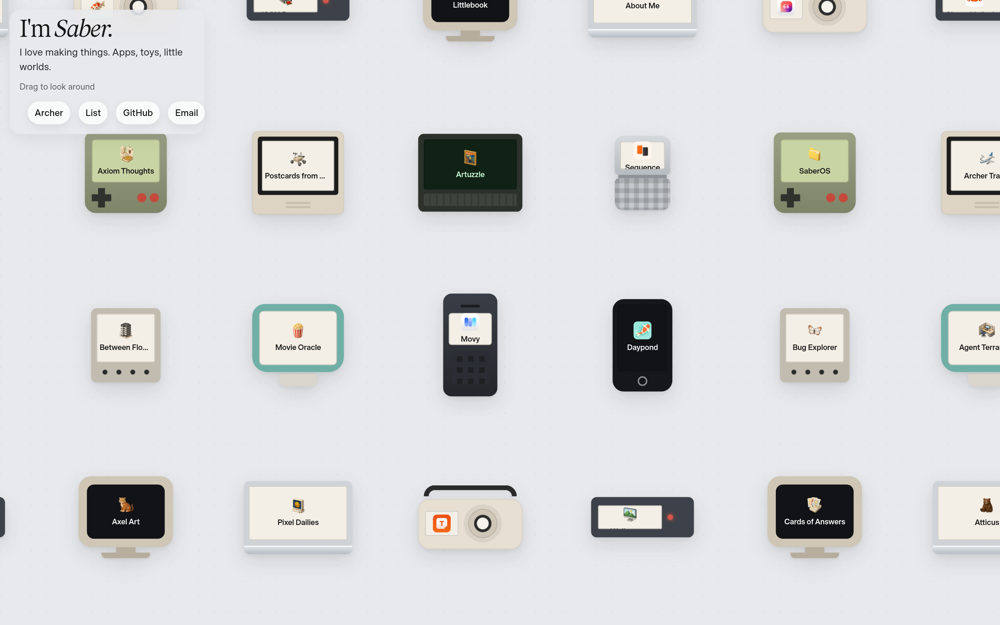

Mobile, 390 wide. The same shells, packed tighter. The corner card covers the top row. The pager’s label is a sliver under the icon.

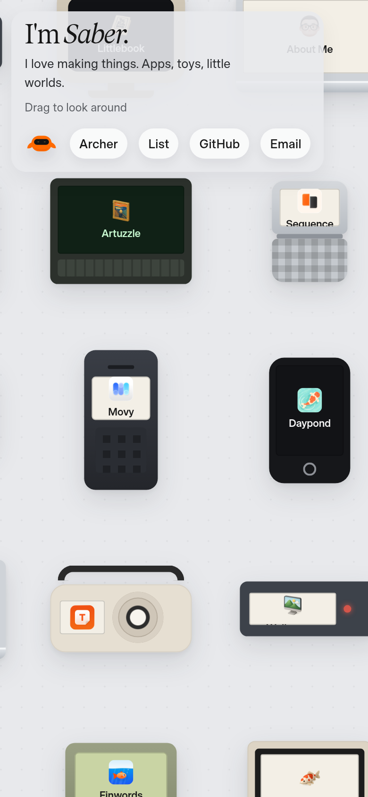

## Candybar

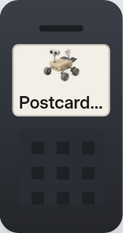
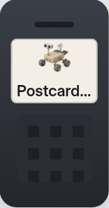

- Name clipped. “Postcards from Mars” paints as “Postcard…” — 50px of horizontal overflow (112px of text in a 62px label) at both widths.
- The icon sits flush with the top edge of the glass.
- Not a candybar. The shell is a flat dark rounded rectangle: no earpiece slots, no microphone, no navigation key, no call and end keys. The keypad is a flat 3×3 grid rather than twelve raised keys.
- The screen is a cream card, not a small green LCD.
- Proportions are a generic tall slab. There is no shoulder, chin, or layered highlight, so it does not read as a 3310-style phone.

## Flip phone

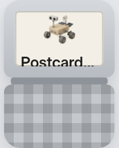
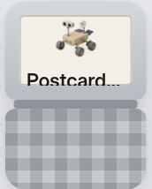

- Name clipped to “Postcard…” — 48px of horizontal overflow.
- The label’s line box is 17px tall inside an 11px client height, so 6px of the text is cut by the bottom of the glass. The icon is flush with the top of a 64×40 screen.
- Not a flip phone. Two gray slabs, a checkerboard where the keys should be, and a plain hinge bar. No metal chin, no earpiece, no thin lid, no antenna.
- The screen is the same cream card as every other device.

## Rotary desk phone

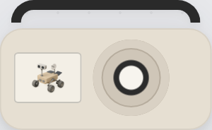
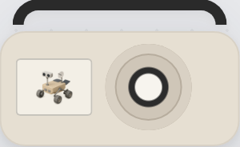

- The name is `display: none`. The screen shows only the icon, so the title never appears.
- The dial is two concentric circles. No finger holes, no finger stop.
- The handset is a thick black arch, not an earpiece and mouthpiece sitting in a cradle.
- The base is a flat cream pill. No feet, no cradle buttons, no sculpted body.
- The “screen” is a cream rectangle with no bezel, so it does not read as a number window.

## Early slab phone

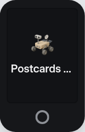
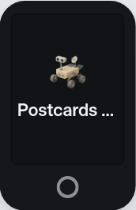

- Name clipped to “Postcards …” — 40px of horizontal overflow in a 72px screen.
- No earpiece slot, no metal band, no rounded glass. The home control is an empty ring floating on a flat black body.
- The icon is a small square in a sea of black, not a glossy home-screen icon.
- One flat fill. No glass highlight, no edge highlight, no chin.

## Handheld console

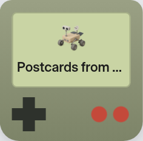
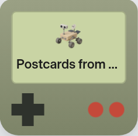

- Name clipped to “Postcards from …” — 14px of horizontal overflow.
- The cross is a flat plus. The two red dots have no letters, and there is no start, no select, no speaker slots, and no power lamp.
- The shell is one olive gradient. The classic brick has a recessed screen well, a darker lower half, and a gray-green body.
- The glass is a pale green card with no dark bezel, so it does not read as a dot-matrix screen.

## Pager

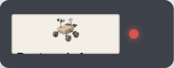
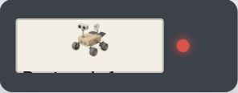

- Severe clip. The screen is 92×34. The 26px icon fills it, and the label is left 5px of client height against a 17px line box, so only the tops of the letters show. Horizontal overflow is 20px on top of that.
- The icon is flush with the top edge of the glass.
- Not recognizable as a pager beyond a dark bar and a red lamp. No clip, no display bezel, no button.

## PDA

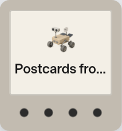
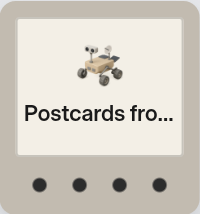

- Name clipped to “Postcards fro…” — 28px of horizontal overflow.
- Four dots stand in for the writing area, the app buttons, and the scroll control.
- Flat beige card. No stylus lane, no power button, no metal edge, no green mono screen.

## Compact Macintosh

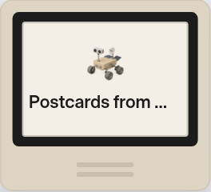

- Name clipped to “Postcards from …” — 8px of horizontal overflow. This is the largest of the small screens and it still cannot hold the longest title on one line.
- The chin is two gray rules, not a disk slot. No feet, no inset bezel depth, no curve in the glass.
- The case is a flat beige box, so the tall compact-Mac silhouette (thick bezel, square tube, slot under the screen) is missing.

## Beige CRT

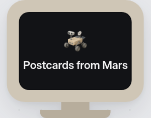
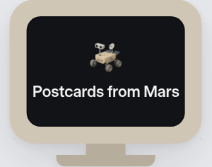

- The longest name fits, with 0px of overflow, in a 112×78 screen. It sits on one line with 4px of side padding, so it is flush and one wider title would clip.
- The stand is a rectangle stacked on a wider rectangle. No neck, no foot, no side depth.
- The glass is flat. No convex highlight, no control buttons, no vents.
- The beige is a single flat fill.

## Bulbous all-in-one

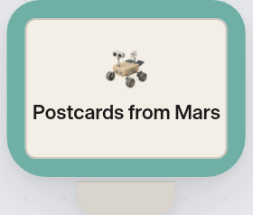
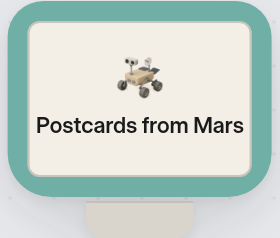

- The longest name fits, with 0px of overflow, on the same flush one-line layout as the CRT.
- The body is a teal rounded rectangle on a plain foot. The egg, the top handle groove, the translucent chin, the hemispherical stand, and the curved tube are all missing.
- One flat color. Nothing suggests translucent plastic.

## Terminal

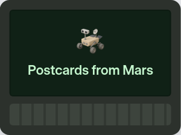
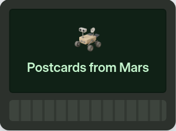

- The longest name fits, in green on a dark green field. That is the right idea, and it is not clipped.
- No phosphor glow, no scan, no curved glass. The type is the same UI sans as every other screen.
- The “keyboard” is a striped bar, not keycaps. The case is a flat dark rounded rectangle, so it does not read as a terminal.

## Laptop

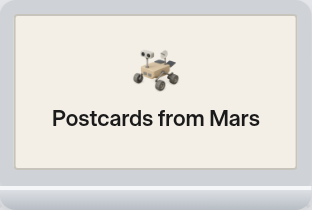
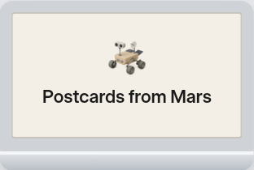

- The longest name fits, with 0px of overflow.
- The object is a lid plus a gradient bar. No hinge, no keyboard, no trackpad, no palm rest.
- It reads as a generic silver slab, not a PowerBook-style clamshell. The screen has no bezel depth.

## Shared

- Every screen uses the same layout: a 26px icon and an 11px nowrap label. Anything wider than the glass becomes an ellipsis. The flip phone and the pager also slice the label vertically.
- Nothing on a screen is styled for that device. LCDs, the terminal, and the slab phone all share one card, with a color swap.
- Shells are flat gradients. Signature parts (navi key, finger holes, home button, D-pad, disk slot, egg shape, phosphor) are missing or reduced to a single shape.
- Devices do not scale with the cell, so 390 and 1440 fail in the same places. At 390 the corner card also covers the top row, which is separate from the bezel clipping.

## After

The pager is gone. The other eleven are inline SVG, and each label sits in a screen rectangle taken from that drawing. LCDs and the terminal use Screen Pixel (Silkscreen). The handset, the compact Mac, the CRT, the all-in-one, and the laptop use the site sans. The handset icon is a glossy rounded tile.

Checked every catalog name (27) on every device at 320, 390, 768, 1440, and 1920. Name and icon overflow is 0 in all 297 mobile pairings and at the other widths. Nothing spills out of its cell.

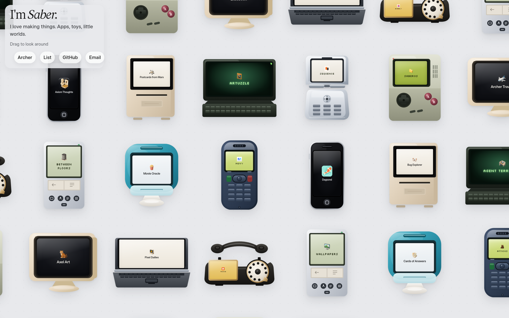

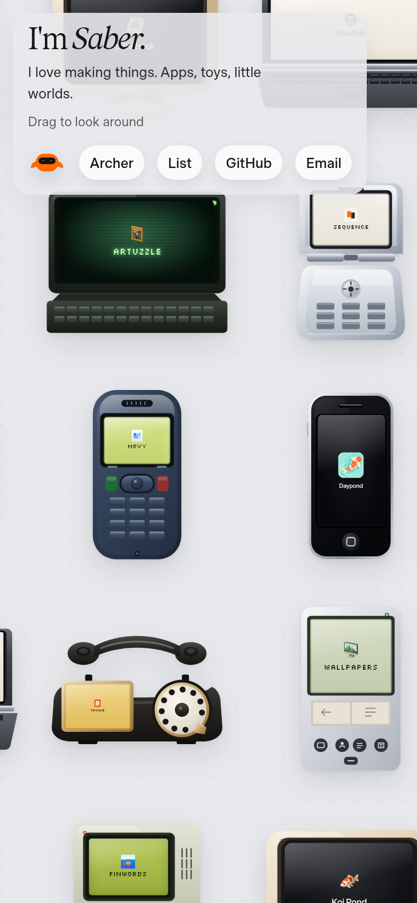

### Candybar

Rounded navy shell, earpiece slots, green LCD, call and end keys, a center navigation key, twelve raised keys, and a microphone hole. “Postcards from Mars” wraps to two pixel lines inside the glass at both widths.

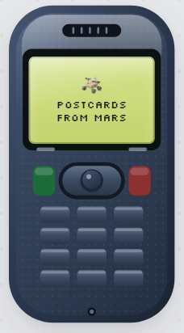
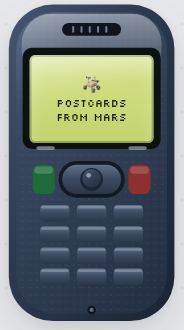

### Flip phone

Silver clamshell, earpiece, metal hinge, flared chin, round navigation pad, and a dark keypad. The title fits on the color screen.

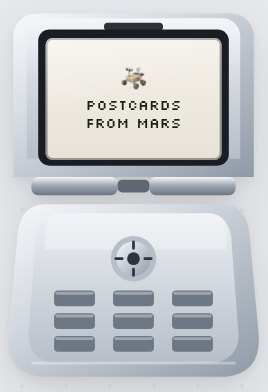
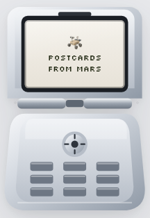

### Rotary desk phone

Handset with an ear and a mouth, cradle posts, amber number window, ten finger holes, a finger stop, and feet. The title is on the window, which the old drawing hid.

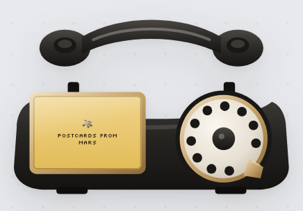

### Early handset

Steel band, earpiece slot, side buttons, rounded glass, a glossy icon, and a home button with a rounded square. The title is set in the site sans, in the weight of a home screen.

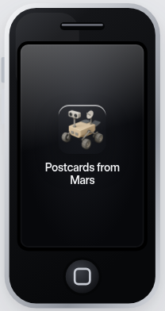
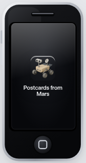

### Handheld

Gray-green brick, power lamp, dark screen well, speaker slots, a cross in a dish, A and B, and start and select. The glass is a green matrix and the title is pixel type.

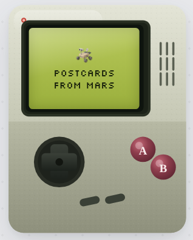
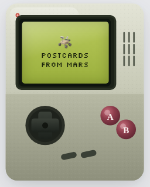

### PDA

Silver body, green lamp, mono screen, split writing area, four marked buttons, a scroll bar, and a stylus groove. The title fits on the mono glass.

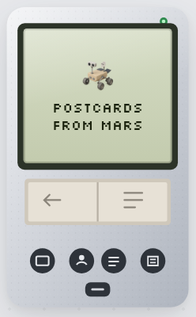
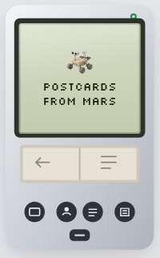

### Compact Macintosh

Beige case with a side edge, thick black bezel, landscape glass, a disk slot, a drive panel, and two feet. No logo. The title fits on the warm white screen.

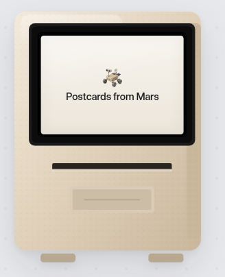
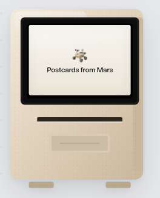

### Beige CRT

Deep bezel, curved glass, side depth, vents, a power lamp, a neck, and an oval foot. The title fits on the dark tube.

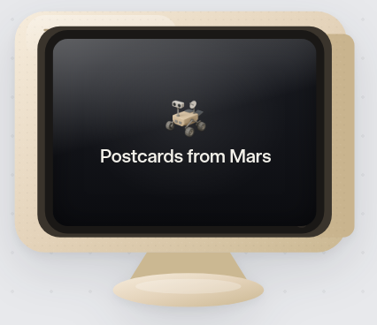
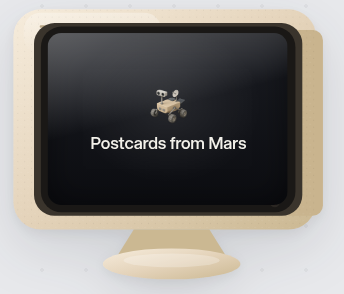

### Bondi all-in-one

Translucent teal shell, handle slot, inset tube, pale chin with a slot, and a dome stand. The title fits on the glass, clear of the chin.

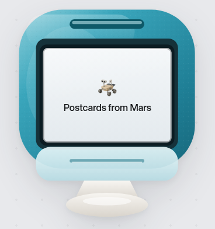
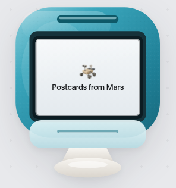

### Terminal

Dark case, curved green glass, scan lines, phosphor type, a power lamp, and two rows of keycaps. The longest title fits on one glowing line.

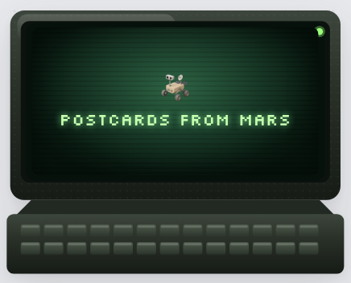
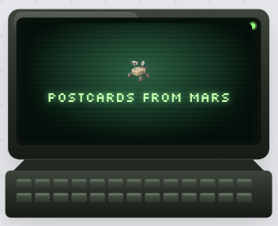

### Laptop

Graphite lid, black bezel, hinge, two rows of keys, and a trackpad with a button. The title fits on the panel.

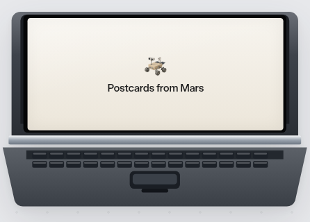
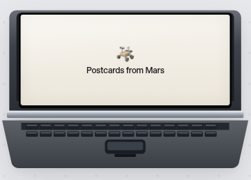

### Result

Zero clipped names or icons at the viewports above. Drag, hover, click, the keyboard list, reduced motion, and touch are unchanged. The corner card on a phone still covers whatever sits under it. That is the page chrome, not the glass.
